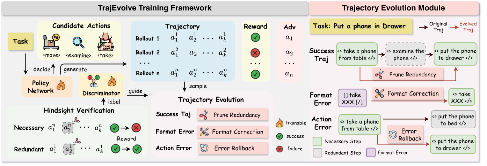

# TrajEvolve: Trajectory Evolution for Reinforcement Learning with Hindsight Credit Assignment



Official implementation of the NeurIPS 2026 paper **"TrajEvolve: Trajectory Evolution for Reinforcement Learning with Hindsight Credit Assignment"**.

## Key Features

- **Hindsight Credit Assignment**: Automatically determines which steps in a successful trajectory are truly necessary by replaying ablated trajectories in the environment.
- **Step-Level Credit Discriminator**: Trains a lightweight discriminator model (e.g., Qwen2.5-1.5B) to predict step-level credit (necessary/redundant) from trajectory context, enabling online credit assignment during RL.
- **Seamless Integration with GRPO**: Extends the GRPO algorithm with trajectory evolution, maintaining the same GPU memory footprint while achieving better training efficiency.

## Table of Contents

- [Key Features](#key-features)
- [Installation](#installation)
  - [Install TrajEvolve](#install-trajevolve)
  - [Install Supported Environments](#install-supported-environments)
    - [1. ALFWorld](#1-alfworld)
    - [2. WebShop](#2-webshop)
- [Pipeline](#pipeline)
  - [Step 1: Credit Analysis (Construct SFT Data)](#step-1-credit-analysis-construct-sft-data)
  - [Step 2: Discriminator Training](#step-2-discriminator-training)
  - [Step 3: RL Training with TrajEvolve](#step-3-rl-training-with-trajevolve)
- [Acknowledgement](#acknowledgement)
- [Citation](#citation)

## Installation

### Install TrajEvolve
```bash
conda create -n trajevolve python==3.12 -y
conda activate trajevolve

pip3 install torch==2.6.0 --index-url https://download.pytorch.org/whl/cu124
pip3 install flash-attn==2.7.4.post1 --no-build-isolation

pip3 install -e .

pip3 install vllm==0.8.5
```

### Install Supported Environments
> ⚠️ **Important:** 
To run an agent in any of these environments, you must first install and configure the corresponding environment. We strongly recommend installing ***each environment in its own dedicated conda environment*** to avoid potential package version conflicts.

#### 1. ALFWorld
Install with pip:
```bash
pip3 install gymnasium==0.29.1
pip3 install stable-baselines3==2.6.0
pip install alfworld
pip install vllm==0.8.5
```

Download PDDL & Game files and pre-trained MaskRCNN detector (will be stored in `~/.cache/alfworld/`):
```bash
alfworld-download -f
```

> **⚠️ Warning:** It is recommended to keep the ALFWorld data in its default location (`~/.cache/alfworld/`). Our trajectory evolution environment relies on the ALFWorld gamefile paths to reproduce and reconstruct environments.

Use `--extra` to download pre-trained checkpoints and seq2seq data.

Play a Textworld game:
```bash
alfworld-play-tw
```
---

#### 2. WebShop
WebShop requires Python <=3.10, so begin by creating a new `trajevolve-webshop` environment:
```bash
conda create -n trajevolve-webshop python==3.10 -y
conda activate trajevolve-webshop
```

Install WebShop:
```bash
cd ./agent_system/environments/env_package/webshop/webshop
./setup.sh -d all
```

Note: If you encounter issues with gdown, you may need to visit `https://drive.google.com/`, get your Google Drive cookie, and paste it into `.cache/gdown/cookies.txt`.
Or you may need to manually download the files.

After WebShop is installed, return to the root directory of the repository and install the TrajEvolve package:
```bash
cd repo_root/
pip3 install torch==2.6.0 --index-url https://download.pytorch.org/whl/cu124
pip3 install flash-attn==2.7.4.post1 --no-build-isolation
pip3 install -e .
pip3 install vllm==0.8.2
# spacy 3.7.2 requires typer<0.10.0,>=0.3.0, but you have typer 0.15.2 which is incompatible.
# weasel 0.3.4 requires typer<0.10.0,>=0.3.0, but you have typer 0.15.2 which is incompatible.
```
The warnings can be safely ignored.

---

## Pipeline

TrajEvolve follows a three-stage pipeline: **(1) Credit Analysis → (2) Discriminator Training → (3) RL Training**.

### Step 1: Credit Analysis (Construct SFT Data)

The first step performs **hindsight credit analysis** on pre-collected trajectories. For each successful trajectory, TrajEvolve ablates individual steps and replays the modified trajectory in the environment to determine whether each step is **necessary** or **redundant** for task completion. The analysis results are saved as structured JSON files that serve as training data for the discriminator.

**ALFWorld:**
```bash
bash agent_system/step_discriminator/trajectory_analyzer/run_credit_analysis_alfworld.sh
```

**WebShop:**
```bash
bash agent_system/step_discriminator/trajectory_analyzer/run_credit_analysis_webshop.sh
```

### Step 2: Discriminator Training

The second step trains a **step-level credit discriminator** via supervised fine-tuning (SFT). The discriminator learns to predict whether a given step is necessary or redundant based on the full trajectory context. The training data is first processed from the credit analysis JSON into Parquet format, then used to fine-tune a language model (e.g., Qwen2.5-1.5B-Instruct) using distributed FSDP training.

**ALFWorld:**
```bash
bash agent_system/step_discriminator/discriminator_trainer/run_training_alfworld.sh
```

**WebShop:**
```bash
bash agent_system/step_discriminator/discriminator_trainer/run_training_webshop.sh
```

### Step 3: RL Training with TrajEvolve

The final step runs **RL training with trajectory evolution**. TrajEvolve extends the GRPO algorithm by periodically invoking the trained discriminator to assess step-level credit for newly collected trajectories. The credit predictions are used to reshape episode-level rewards—penalizing trajectories with redundant steps and encouraging efficient solutions.

**ALFWorld:**
```bash
bash examples/traj_evolve_trainer/run_alfworld.sh
```

**WebShop:**
```bash
bash examples/traj_evolve_trainer/run_webshop.sh
```

Key TrajEvolve-specific parameters (configurable in the training scripts):
| Parameter | Description | Default |
|-----------|-------------|---------|
| `traj_evolve.alpha` | Weight for redundancy penalty | 1.0 |
| `traj_evolve.evolve_freq` | Frequency (in epochs) of discriminator updates | 5 |
| `traj_evolve.discriminator_model_path` | Path to the trained discriminator model | - |
| `traj_evolve.discriminator_lr` | Learning rate for online discriminator fine-tuning | 1e-5 |
| `traj_evolve.discriminator_epochs` | Number of epochs for online discriminator updates | 1 |
| `traj_evolve.step_credit_value` | Credit value threshold for step classification | 0.5 |

## Acknowledgement

`TrajEvolve` is built upon [verl-agent](https://github.com/langfengQ/verl-agent) and [veRL](https://github.com/volcengine/verl). The supported environments are adapted from [ALFWorld](https://github.com/alfworld/alfworld) and [WebShop](https://github.com/princeton-nlp/WebShop). We extend our sincere gratitude to the authors and contributors of these projects for their outstanding work.

## Citation
If you find `TrajEvolve` useful in your research or applications, we would appreciate it if you could cite our work:

```
@inproceedings{trajevolve,
  title={TrajEvolve: Trajectory Evolution for Reinforcement Learning with Hindsight Credit Assignment},
  booktitle={Advances in Neural Information Processing Systems (NeurIPS)},
  year={2026}
}
```
